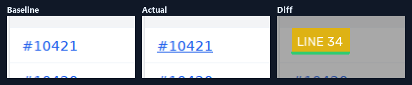

# VisTest

[](https://pypi.org/project/vistest/) [](https://pypi.org/project/vistest/) [](https://github.com/marshlw/vistest/actions/workflows/ci.yml)

**Screenshot assertions for Python Playwright and pytest.** VisTest marks what changed in the screenshot and describes the change in the test failure.



**[Run the demo ↓](#run-the-demo)** · [Add a pytest check](#add-a-pytest-check) · [Русский](https://github.com/marshlw/vistest/blob/main/README.ru.md)

## Run the demo

With Python 3.11+, compare two screenshots from the browser corpus. The CLI runs the comparison directly.

```bash
python -m pip install vistest==0.2.0a5
curl -fLO https://raw.githubusercontent.com/marshlw/vistest/9cd30b0ad550df84bc0c476c3dca0191b6b9c706/tests/browser_corpus/frames/table/base.png
curl -fLO https://raw.githubusercontent.com/marshlw/vistest/9cd30b0ad550df84bc0c476c3dca0191b6b9c706/tests/browser_corpus/frames/table/underline--on.png
vistest compare base.png underline--on.png
```

VisTest reports `line added: 57×1 px, #2563eb`, exits with code `1` for the detected difference, and writes the annotated screenshot to `vistest-diff/boxes.png`.

## Add a pytest check

`[browser]` installs Playwright and `pytest-playwright`, which provides the `page` fixture.

```bash
python -m pip install --pre "vistest[browser]"
python -m playwright install chromium
```

Point the test at your running application and save it as `tests/test_visual.py`.

```python
from vistest import expect_screenshot


def test_home(page):
    page.goto("http://localhost:8000")
    expect_screenshot(page, "home.png")
```

Create the missing baseline locally and rerun the comparison.

```bash
python -m pytest tests/test_visual.py --vistest-update=missing
python -m pytest tests/test_visual.py
```

Review and commit the PNG and its renderer metadata under `tests/__vistest__/`. Add `.vistest/` to `.gitignore` for run artifacts.

On a failure, open `.vistest/report/index.html` for the baseline, actual screenshot, diff, and changed regions. You can also capture a Playwright locator or mask dynamic areas. [Capture options](https://github.com/marshlw/vistest/blob/main/docs/GUIDE.md#expect_screenshot)

## Run in CI

Pin the runner image and Playwright version. Compare against baselines captured in the same environment. Install `pytest-xdist` for parallel workers.

```bash
python -m pytest tests/test_visual.py -n auto --vistest-require-checks \
  --vistest-json-report=.vistest/results.json
```

Upload `.vistest/` after the job even if pytest fails. Use `--vistest-require-snapshots=ci/required.json` when a job must compare specific snapshot and platform pairs. [CI JSON and manifest format](https://github.com/marshlw/vistest/blob/main/docs/GUIDE.md#ci-json-report)

After reviewing an intentional change, use the baseline path from the failure, relative to `tests/__vistest__/`.

```bash
python -m pytest tests/test_visual.py --vistest-update=changed \
  --vistest-update-snapshot=linux-chromium-1x-1280x720/home.png
```

To investigate inconsistent verdicts, save one JSON report per run with the same test selection, environment and baseline set.

```bash
vistest diagnose run-1.json run-2.json run-3.json
```

## Documentation

- [Library guide](https://github.com/marshlw/vistest/blob/main/docs/GUIDE.md) covers configuration, capture, artifact formats and CLI commands.
- [Runnable Playwright example](https://github.com/marshlw/vistest/blob/main/examples/test_library.py) covers page and locator screenshots.
- [Engine behavior and limitations](https://github.com/marshlw/vistest/blob/main/docs/GUIDE.md#the-engine) explains how VisTest handles rendering noise. [Development journal](https://github.com/marshlw/vistest/blob/main/docs/dev/journal.md#f5-engine-v2-by-default) records the browser comparison and its test conditions.
- [QA roadmap](https://github.com/marshlw/vistest/blob/main/docs/dev/roadmap.md) · [Changelog](https://github.com/marshlw/vistest/blob/main/CHANGELOG.md) · [Apache-2.0 license](https://github.com/marshlw/vistest/blob/main/LICENSE)
