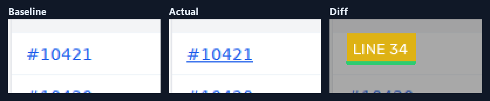

# VisTest

[](https://pypi.org/project/vistest/) [](https://pypi.org/project/vistest/) [](https://github.com/marshlw/vistest/actions/workflows/ci.yml)

**Скриншотные проверки для Python Playwright и pytest.** VisTest отмечает изменившиеся области на снимке и описывает их в сообщении об ошибке.



**[Запустить демо ↓](#запустить-демо)** · [Добавить проверку в pytest](#добавить-проверку-в-pytest) · [English](https://github.com/marshlw/vistest/blob/main/README.md)

## Запустить демо

На Python 3.11+ сравните два готовых снимка из браузерного корпуса. Для сравнения достаточно CLI.

```bash
python -m pip install vistest==0.2.0a5
curl -fLO https://raw.githubusercontent.com/marshlw/vistest/9cd30b0ad550df84bc0c476c3dca0191b6b9c706/tests/browser_corpus/frames/table/base.png
curl -fLO https://raw.githubusercontent.com/marshlw/vistest/9cd30b0ad550df84bc0c476c3dca0191b6b9c706/tests/browser_corpus/frames/table/underline--on.png
vistest compare base.png underline--on.png
```

VisTest найдёт добавленную линию `57×1 px` цвета `#2563eb`, завершится с кодом `1` из-за обнаруженного различия и запишет diff в `vistest-diff/boxes.png`.

## Добавить проверку в pytest

Набор зависимостей `[browser]` устанавливает Playwright и плагин `pytest-playwright` с фикстурой `page`.

```bash
python -m pip install --pre "vistest[browser]"
python -m playwright install chromium
```

Укажите адрес запущенного приложения и сохраните тест в `tests/test_visual.py`.

```python
from vistest import expect_screenshot


def test_home(page):
    page.goto("http://localhost:8000")
    expect_screenshot(page, "home.png")
```

Создайте отсутствующий эталон локально и повторите сравнение.

```bash
python -m pytest tests/test_visual.py --vistest-update=missing
python -m pytest tests/test_visual.py
```

Проверьте и закоммитьте PNG и метаданные рендера из `tests/__vistest__/`. Добавьте `.vistest/` в `.gitignore` для артефактов прогонов.

При падении откройте `.vistest/report/index.html`. В отчёте есть эталон, фактический снимок, diff и описание изменившихся областей. Можно снимать отдельный Playwright Locator или закрывать динамические области маской. [Параметры съёмки](https://github.com/marshlw/vistest/blob/main/docs/GUIDE.md#expect_screenshot)

## Запустить в CI

Закрепите образ раннера и версию Playwright. Сравнивайте с эталонами из той же среды. Для параллельного запуска установите `pytest-xdist`.

```bash
python -m pytest tests/test_visual.py -n auto --vistest-require-checks \
  --vistest-json-report=.vistest/results.json
```

Выгружайте `.vistest/` в артефакты даже при падении pytest. Если в задании CI должны сравниваться конкретные пары снимков и платформ, добавьте `--vistest-require-snapshots=ci/required.json`. [JSON-отчёт и формат манифеста](https://github.com/marshlw/vistest/blob/main/docs/GUIDE.md#ci-json-report) · [Пример для GitHub Actions](https://github.com/marshlw/vistest/blob/main/docs/GUIDE.md#github-actions-example)

После ревью намеренного изменения возьмите из сообщения об ошибке путь к эталону относительно `tests/__vistest__/`.

```bash
python -m pytest tests/test_visual.py --vistest-update=changed \
  --vistest-update-snapshot=linux-chromium-1x-1280x720/home.png
```

Если вердикт меняется от прогона к прогону, сохраните отдельный JSON для каждого запуска с тем же набором тестов, окружением и эталонами.

```bash
vistest diagnose run-1.json run-2.json run-3.json
```

## Документация

- [Руководство](https://github.com/marshlw/vistest/blob/main/docs/GUIDE.md) с настройками съёмки, форматами артефактов и командами CLI.
- [Готовый пример Playwright](https://github.com/marshlw/vistest/blob/main/examples/test_library.py) со снимками страницы и отдельного элемента.
- [Работа движка и его ограничения](https://github.com/marshlw/vistest/blob/main/docs/GUIDE.md#the-engine). [Журнал разработки](https://github.com/marshlw/vistest/blob/main/docs/dev/journal.md#f5-engine-v2-by-default) содержит результаты браузерного сравнения и условия прогона.
- [Дорожная карта QA](https://github.com/marshlw/vistest/blob/main/docs/dev/roadmap.md) · [Изменения по версиям](https://github.com/marshlw/vistest/blob/main/CHANGELOG.md) · [Лицензия Apache-2.0](https://github.com/marshlw/vistest/blob/main/LICENSE)
